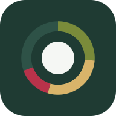

# תזונה ומשקל

אפליקציה בעברית למעקב אחרי תזונה ומשקל, לירידה בריאה במשקל.
עובדת בטלפון אנדרואיד, גם בלי אינטרנט. הנתונים שלך נשארים אצלך: בטלפון, ואם רוצים גם בגוגל דרייב שלך.

**כתובת האפליקציה:** https://iskarbnik.github.io/nutrition-app/

## מה יש באפליקציה

- **מסך ראשי:** כמה קלוריות נשארו להיום, חלבון, פחמימות ושומן, מים, קפה, צעדים, ומגמת המשקל.
- **ארוחות:** בוקר, צהריים, ערב ונשנושים. מוסיפים אוכל בשלוש דרכים:
  - **צילום** של הצלחת (עם AI)
  - **חיפוש** ברשימה של כ-190 מזונות נפוצים בישראל
  - **תיאור חופשי**, למשל "חביתה משתי ביצים ו-2 פרוסות לחם" (עם AI)
  - אפשר לתקן כל ערך, לשמור ארוחות קבועות, ולבחור מהאחרונים.
- **יעדים אוטומטיים:** קלוריות וחלבון, שומן ופחמימות, לפי הגיל, המין, הגובה, המשקל ורמת הפעילות. אפשר גם לקבוע ידנית.
- **מדדים:** משקל, אחוז שומן, היקף מותניים וגובה לפי תאריך, עם גרפים, קו יעד, ממוצע של 7 ימים, והערכה מתי מגיעים ליעד.
- **מחזור:** סימון ימים, שמופיע על גרף המשקל.
- **מים וקפה:** הוספה מהירה. לכל סוג קפה הערכים שלו.
- **פעילות:** צעדים וגרף שבועי.
- **סיכום שבועי** עם טיפ קצר מ-AI.
- **תזכורות** לשקילה, למים ולארוחות, עם מתג לכל אחת.
- **גיבוי בגוגל דרייב:** סנכרון אוטומטי, גיבוי יומי של 30 הימים האחרונים, ושחזור.

## התקנה בטלפון אנדרואיד

1. פותחים את **Chrome** בטלפון.
2. נכנסים לכתובת: https://iskarbnik.github.io/nutrition-app/
3. לוחצים על **⋮** (שלוש הנקודות למעלה) ← **"התקנת אפליקציה"** (או "הוספה למסך הבית").
4. מאשרים. מופיע אייקון של צלחת במסך הבית.
5. פותחים מהאייקון. האפליקציה נפתחת במסך מלא, כמו כל אפליקציה.

אם Chrome מציע בעצמו "להתקין את האפליקציה" בתחתית המסך, אפשר ללחוץ שם.

## הגדרה ראשונה

### 1. פרטים אישיים
**הגדרות ← פרטים אישיים:** שם, שנת לידה, מין, גובה, רמת פעילות ומשקל יעד.
אחר כך ב-**מדדים** מזינים משקל אחד, ומיד מחושבים היעדים היומיים.

### 2. מפתח AI (לצילום ולתיאור חופשי)
בלי מפתח עובד רק החיפוש ברשימה. כדי להשתמש בצילום ובתיאור חופשי, צריך מפתח אישי מאחד הספקים:

| ספק | עלות | איפה יוצרים מפתח |
|---|---|---|
| **Gemini** (ברירת מחדל) | יש שכבה חינמית | https://aistudio.google.com/apikey |
| **Claude** | בתשלום, בערך אגורות לתמונה | https://console.anthropic.com/settings/keys |

**הגדרות ← זיהוי אוכל עם AI:** בוחרים ספק, מדביקים את המפתח ולוחצים "שמירת מפתח".

- המפתח נשמר רק בטלפון. הוא לא עולה לדרייב ולא לשום מקום אחר.
- בשכבה החינמית של Gemini, Google עשויה להשתמש בנתונים לשיפור המוצרים שלה.

### 3. גיבוי בגוגל דרייב (מומלץ)
**הגדרות ← גיבוי בגוגל דרייב ← "חיבור לגוגל דרייב"**, ומאשרים בחלון של גוגל.

- האפליקציה רואה רק את הקבצים שהיא יצרה, בתיקייה **"תזונה ומשקל"** בדרייב שלך.
- כל שינוי נשמר בדרייב אחרי כמה שניות. בלי אינטרנט, הסנכרון מחכה ומשלים לבד.
- **רענון מהדרייב:** טוען את הנתונים מהדרייב, למשל אחרי התקנה מחדש.
- **שחזור מגיבוי:** חוזרים ליום מסוים. לפני השחזור נשמר גיבוי של המצב הנוכחי.

> בזמן שהאפליקציה במצב בדיקה אצל Google, רק משתמשים שנוספו לרשימת הבודקים יכולים להתחבר לדרייב. ההסבר למפתחים: [docs/google-setup.md](docs/google-setup.md).

## פרטיות

- הנתונים נשמרים בטלפון, ואם התחברת, גם בדרייב שלך. אין שרת שלנו ואין מאגר נתונים משותף.
- תמונות ותיאורי אוכל נשלחים רק לספק ה-AI שבחרת, ורק כשמבקשים חישוב.
- ניקוי נתוני האתר ב-Chrome מוחק את הנתונים מהטלפון. לכן כדאי לחבר את הדרייב.

## מגבלות

- **צעדים:** אפליקציית אינטרנט לא יכולה לקרוא צעדים מהטלפון. מזינים ידנית, למשל מ-Google Fit.
- **תזכורות:** בלי שרת, תזכורת מגיעה בצורה אמינה רק כשהאפליקציה פתוחה או ברקע לזמן קצר. מה שהוחמץ מוצג כשפותחים את האפליקציה.
- **התחברות לגוגל:** נשמרת עד שעה. אחרי זה מופיע "צריך להתחבר מחדש", ולחיצה אחת מחברת שוב.
- **ערכי המזונות ברשימה** הם ערכים טיפוסיים. אפשר לתקן כל פריט.
- **ארוחות** נרשמות ליום הנוכחי בלבד.

## עדכונים

כשיוצאת גרסה חדשה, מופיע למעלה "יש גרסה חדשה של האפליקציה". לוחצים "רענון".

---

## למפתחים

- **בלי שלב בנייה:** HTML, CSS ו-JavaScript רגילים. כל קובץ לוגיקה ב-`js/` עובד גם בדפדפן וגם ב-Node.
- **בדיקות:** `npm test` (נדרש Node 20 ומעלה).
- **הרצה מקומית:** כל שרת סטטי, למשל `npx http-server -p 8080 -c-1`, ואז http://localhost:8080
- **מבנה:**
  - `js/` — לוגיקה: יעדים, יומן, מזונות, AI, סנכרון, תזכורות, תאריכים
  - `js/ui/` — מסך לכל קובץ
  - `sw.js` — עבודה בלי אינטרנט. **בכל שינוי בקבצים מעלים את `VERSION`.**
  - `js/config.js` — שמות מודלי AI ומזהה הלקוח של Google
- **פריסה:** GitHub Pages מהענף `main`, מהתיקייה הראשית.
- **מסמכים:** [מסמך העיצוב](docs/superpowers/specs/2026-10-24-nutrition-pwa-design.md), [תוכנית הבנייה](docs/superpowers/plans/2026-10-24-nutrition-pwa.md), [הגדרת גוגל](docs/google-setup.md).

